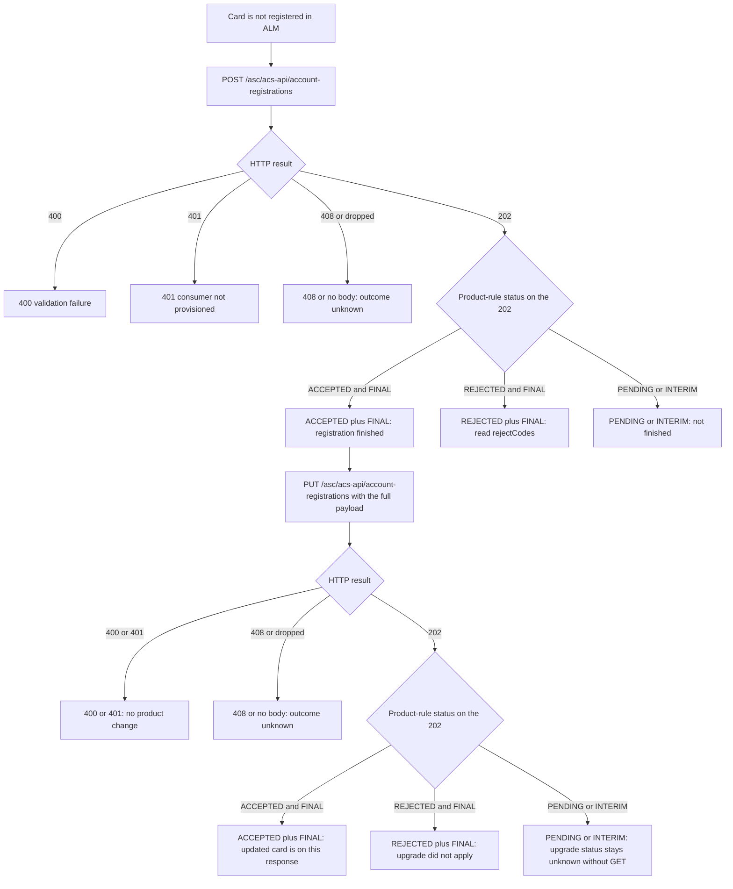
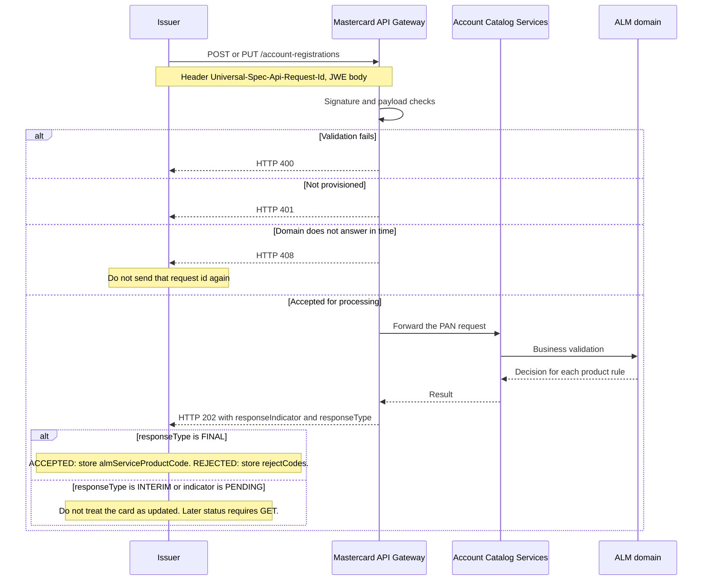

# Card ALM: POST then PUT, without GET or delete

Date checked: 2026-10-17.

This note records the Account Catalog Services (ACS) contract for a card-level Account Level Management (ALM) build that registers a PAN with `POST`, later changes that registration with `PUT`, and does not implement `GET` or delete.

The contract is Account Catalog Services API **3.1.1**. Card calls use `/asc/acs-api/account-registrations`. Account-range calls use a different resource and are not a substitute for the card API.

## Conclusion

`POST` then `PUT` is the right sequence for a card that is not yet in ALM.

Both calls are synchronous. Each successful call returns **HTTP 202** and the status of that step on the same response. The updated card is visible on that body when the product rule is `ACCEPTED` and `responseType` is `FINAL`.

`GET` is not required for a call that already came back `FINAL`. `GET` is required when the body is `INTERIM` or `PENDING`, or when the call times out or the connection drops. Without `GET`, those cases stay unknown.

Delete is a separate operation. Leaving it out means the PAN cannot be removed from ALM through this API.

## Workflow

The same flow is drawn twice: Mermaid source below, and the SVG file [card-alm-post-put-workflow.svg](../diagrams/card-alm-post-put-workflow.svg).

### Decision flow

### Sequence of one write

## The four card operations

All four are on the card registration resource. Payloads are marked `x-mastercard-api-encrypted` (JWE).

| Operation | Method and path | Role in this build |
| --- | --- | --- |
| `registerAccount` | `POST /account-registrations` | Required first. Registers one PAN. The Product Graduation use case sends the PAN and the product on this call. |
| `updateAccount` | `PUT /account-registrations` | Required for a later change. Updates a PAN that is already registered. The entire payload must be sent. |
| `getAccountRegistrationStatus` | `GET /account-registrations?correlation_id=` | Not in this build. Re-reads one earlier request. It does not look a card up by PAN. |
| `deleteAccountRegistration` | `POST /account-registrations/delete-registrations` | Not in this build. Removes the registration or specific product rules. |

Base URLs from the 3.1.1 specification:

- Sandbox: `https://sandbox.api.mastercard.com/asc/acs-api`
- Production: `https://api.mastercard.com/asc/acs-api`

Every POST, PUT, and delete sends header `Universal-Spec-Api-Request-Id`. It is 1–255 characters from `[0-9A-Za-z-]`, it must be unique across requests, and a version-4 UUID is recommended. Reuse is rejected as a duplicate (`R0000371`). On GET, that same value is the query parameter `correlation_id`.

## What POST and PUT return

The HTTP call is synchronous. The operation summaries are “Send the single account for synchronous registration processing” and “Synchronously update a single account registration.” The overview says the gateway returns a synchronous response after ALM has accepted or rejected the PAN. The support FAQ gives the synchronous timing target as an average of 1 second and a maximum of 3 seconds.

Success for both writes is **HTTP 202**:

- POST: “Request accepted for processing.” Schema `AccountRegistrationResult`.
- PUT: “Update request accepted for processing.” Schema `AccountUpdateResult`.

The decision is on each entry of `accountLevelManagement.productRules[]`, not in the HTTP status alone.

| Field | Values | Meaning |
| --- | --- | --- |
| `responseIndicator` | `ACCEPTED`, `REJECTED`, `PENDING` | What ALM decided for that product rule |
| `responseType` | `INTERIM`, `FINAL` | Whether that decision can still change |
| `productRuleId` | Mastercard id, up to 36 characters | Rule that was registered or updated |
| `almServiceCode` | 3–5 characters; `00126` when the PAN is in no ALM service | Active ALM service or combination |
| `almServiceProductCode` | 3 characters, or `XXX` | Graduated or registered product |
| `almServiceProductClass` | 3 characters, or `XXX` | Product class used for rate override |
| `accountCategoryCode` | one letter | Registered category code |
| `actionCodes` | up to 30 codes | Acceptance detail |
| `rejectCodes` | up to 30 codes | Rejection detail |
| `almServiceRateType` | 3 characters, or `XXX` | Rate type for the ALM service |
| `serviceClassificationCodes` | up to 30 codes | Account-level service classification |

`responseType` is defined as:

- `FINAL` — the response is not subject to revision by a subsequent system action.
- `INTERIM` — the response is subject to revision by a subsequent system action.

The schema example for `responseType` is `INTERIM`. A 202 must be read. It is not final unless the field says `FINAL`.

Other synchronous results, with an error object rather than a product-rule decision:

| HTTP | When | Reason codes cited by the specification |
| --- | --- | --- |
| 400 | Header, JSON, PAN, or field validation failed | `R0000370` missing request id, `R0000371` duplicate request id, `R0000373` bad JSON, plus PAN and product-rule codes |
| 401 | Consumer is not provisioned | `R0000372` |
| 408 | The server, or the ALM domain, did not answer in time | `R0000386` server timeout; `R0009500` domain response not received; `R0009050` domain not found |
| 500 | System failure | `R0000385`, retry only when `Recoverable` is true |

`R0009500` is annotated in the codes page as “ARE delete -> HTTP 408 PENDING”. That note is the timeout error for an account-range delete. It is not the product-rule value `PENDING`.

## When the updated card is visible

The updated card is on the POST or PUT response itself when that product rule is `ACCEPTED` and `responseType` is `FINAL`. The product to store is `almServiceProductCode`. `GET` is not required for that call.

`GET` does not query by PAN. It inquires about one previously submitted request:

`GET /asc/acs-api/account-registrations?correlation_id={Universal-Spec-Api-Request-Id}`

Success is HTTP 200, schema `AccountRegistrationInquiryResult`, with the same product-rule decision fields. GET errors include:

- 400 `R0009200`, `R0009201`, `R0009203` — missing, invalid, or over-long `correlation_id`
- 403 `R0009204` — caller may not read that id
- 403 `R0009205` — GET is not supported for that id
- 404 `R0009206` — no data for that id

`R0009205` means some request ids cannot be re-read. GET is the status channel, and it is not guaranteed for every id.

Commit the issuer product only for a final decision:

- `ACCEPTED` + `FINAL` — store the graduated product.
- `REJECTED` + `FINAL` — store the rejection and `rejectCodes`. Do not change the local product.
- `PENDING`, or any `INTERIM` — leave the local product unchanged.
- 408, or a dropped connection after the write may have reached Mastercard — leave the local product unchanged. Do not send the same request id again.

## When `INTERIM` or `PENDING` appears

The public contract defines the two values. It does not list the products, regions, or attributes that cause Mastercard to return them.

They appear only inside a successful 202 (or a later GET 200), on a product rule:

- `responseIndicator` `PENDING` means that rule is not yet `ACCEPTED` or `REJECTED`. The same three values are defined for delete results.
- `responseType` `INTERIM` means the decision on that rule, including an `ACCEPTED` decision, may still be revised.

The fields are independent. `ACCEPTED` together with `INTERIM` is allowed by the schema. The overview says a later update, if one exists after the synchronous response, used to be pushed to the issuer. That push is the deprecated Detail Response API. Its outbound schema says the pushed `responseType` should be `FINAL`. Mastercard now says to use GET, and it is not onboarding new customers to the outbound API.

These are different outcomes and are not `INTERIM` or `PENDING`:

- HTTP 400 is a validation failure and has no product-rule status.
- HTTP 408 is a timeout and has no product-rule status.

The only published write example found with these fields filled in is an **account-range** rule update, `PUT /asc/acs-api/account-ranges`, which returns `responseIndicator` `ACCEPTED` and `responseType` `FINAL` on that response. That resource is not the card registration API. It shows that a write can come back final. It does not prove that a card POST or PUT always does.

The in-process sample at `samples/mastercard-card-upgrade` always returns `INTERIM` on POST and PUT and stores `FINAL` for a later GET. That is the local simulator. It is not a Mastercard rule.

For this program, the way to see which registrations and product changes come back `FINAL` on the write is a sandbox POST and a sandbox PUT.

## POST then PUT, with no GET and no delete

This is a complete path only for cards that stay registered, and only for calls that return `FINAL`.

`POST` enrolls the PAN. The Product Graduation use case is explicit: the customer sends the PAN and the upgrade or downgrade product with `POST /account-registrations`, ALM validates and registers it, and the response carries the account category code plus accept or reject codes.

`PUT` then changes a PAN that is already registered. The specification says the entire payload must be submitted. Missing fields are treated as blank and overwrite values already stored. Attributes at risk include group id, rewards program, registered product, co-brand, expiry, and replaced PAN. `GET` does not return the current PAN image, because it is keyed by a prior request id. The issuer has to keep the last full registration and send it again on every PUT.

Without `GET`:

- An `INTERIM` or `PENDING` rule never resolves.
- There is no replacement for the deprecated asynchronous final notification.
- A 408 or a dropped connection cannot be recovered, and the request id cannot be reused.
- A process that dies after the send and before the 202 is stored has no independent way to read the outcome.

Without delete:

- The PAN or a product rule cannot be removed through `POST /account-registrations/delete-registrations`.
- Closing or clearing fields inside `PUT` is a full replacement, not the delete operation. Any field left out is wiped.

The testing guide adds a scope limit: “Currently PUT and DELETE operations are supported only for MasterCard One Credential Testing and ALM Commercial Flexible Interchange PAN.” Confirm this issuer program is in that set before depending on card `PUT`. The documented Product Graduation enrollment itself is the `POST`.

## What a PUT-only build would have lost

A build that implemented only `PUT` would still receive a synchronous 202, and a `FINAL` plus `ACCEPTED` body would still show the graduated product. It would not be able to enroll a new PAN. Official Product Graduation starts with `POST`. It would also keep the full-payload overwrite risk, the unfinished `INTERIM` and `PENDING` cases, and the 408 recovery gap.

Adding `POST` before `PUT` covers enrollment and a later product change. It does not close the status gap for non-final responses.

## Implementation check: POST, PUT, and GET

Checked on 2026-10-17 against `samples/mastercard-card-upgrade`. This is a comparison of the sample with the decision to keep POST, PUT, and GET, to skip delete, and to store each response for later. It is not a workplace finding. Records outside this repository were not reviewed.

The POST, PUT, and GET decision matches the sample. Leaving out delete does not: the sample still closes a card by calling delete.

| Claim | What the code does | Result |
| --- | --- | --- |
| POST registers the PAN | `RegisterPanAsync` sends `POST /asc/acs-api/account-registrations`. `UpgradeAsync` registers first when the card is not registered. | Confirmed |
| PUT changes an existing registration | `UpdatePanProductAsync` sends `PUT` to the same path, with the stored `productRuleId`. | Confirmed |
| GET resolves an unfinished write | A `Submitted` register or upgrade immediately calls `GetStatusAsync`, which is `GET ?correlation_id=`. HTTP 408 and a dropped connection are stored as `Unknown` and are not retried with the same request id. | Confirmed |
| Store the response for later | Each migration keeps `CorrelationId`, `MastercardRequestId`, `ProductRuleId`, and `MastercardRawResponse`. The card keeps `LastAcsRequestId`, `AcsProductRuleId`, and `NetworkProductCode`. The issuer product changes only when the stored result is `ACCEPTED` and `FINAL` (`MigrationStatus.Active`). `INTERIM` and `PENDING` stay `Submitted`. | Confirmed for this sample |
| No delete | `CloseAsync` calls `DeleteRegistrationAsync`, which is `POST /account-registrations/delete-registrations?services=ALM`. Rollback is another PUT, not a delete. | The sample goes beyond the decision |

Two storage limits matter if these responses are kept for a later PUT:

- The saved PUT body is only PAN, expiry, product code, and product-rule id. That is enough for this sample. It is not the full ACS registration. A later PUT that omits group, rewards, or co-brand fields would still wipe them at Mastercard.
- Persistence is off unless `CardStorePath` is set. The default in `appsettings.json` is empty, so the stored responses last only for the process. The example file `App_Data/cards.json` would also store the clear PAN.

The end-to-end set to keep is POST, PUT, and GET, with the request id and the response stored, and with the local product updated only from a `FINAL` acceptance. Delete remains a separate close operation. Dropping it matches the decision and removes something the current sample still does.

## Scope that this note does not decide

- Which source and target product codes and which BIN ranges this issuer is allowed to use.
- Whether this program’s sandbox POST and PUT return `FINAL` on the write. The public text does not say.
- Whether `R0009205` applies to request ids from this project. If it does, GET cannot recover those calls either.
- The provisioned project’s OpenAPI, if it differs from public 3.1.1. The package rule is to stop and resolve a conflict with Mastercard rather than pick the easier contract.

## References checked on 2026-10-17

“Body read” means the markdown or YAML content was retrieved and used. “URL only” means the URL returned HTTP 200 and the fetched document was the Mastercard Developers application shell, so the scenario text was not taken from that fetch.

| Source | URL | Check |
| --- | --- | --- |
| ACS overview, including synchronous processing and the deprecated detail-response push | https://developer.mastercard.com/account-catalog-services/documentation/ | HTTP 200, body read (`index.md`) |
| API reference index, naming the three specifications | https://developer.mastercard.com/account-catalog-services/documentation/api-reference/ | HTTP 200, body read |
| Account Catalog Services API page, version 3.1.1 and the swagger URL | https://developer.mastercard.com/account-catalog-services/documentation/api-reference/account-catalog-services-api/ | HTTP 200, body read |
| Account Catalog Services API swagger 3.1.1 | https://static.developer.mastercard.com/content/account-catalog-services/swagger/acs-api-swagger.yaml | HTTP 200, body read |
| Deprecated swagger named on that API page | https://static.developer.mastercard.com/content/account-catalog-services/swagger/acs-api-swagger-deprecated.yaml | HTTP 200, not used for the decision rules |
| Detail Response API page: deprecated, use GET, no new outbound onboarding | https://developer.mastercard.com/account-catalog-services/documentation/api-reference/account-catalog-services-detail-response-api/ | HTTP 200, body read |
| Detail Response outbound swagger | https://static.developer.mastercard.com/content/account-catalog-services/swagger/acs-api-outbound.yaml | HTTP 200, body read |
| Account Range Enablement API page | https://developer.mastercard.com/account-catalog-services/documentation/api-reference/account-enablement-api/ | HTTP 200, page exists; card rules were taken from the registration swagger, not from this API |
| Use-case index | https://developer.mastercard.com/account-catalog-services/documentation/use-cases/ | HTTP 200, body read |
| Product Graduation PAN use case (`POST /account-registrations`) | https://developer.mastercard.com/account-catalog-services/documentation/use-cases/pan-registration/product_graduating_pan/ | HTTP 200, body read |
| Testing guide, including the PUT and delete support note and the Insomnia collection mention | https://developer.mastercard.com/account-catalog-services/documentation/testing/ | HTTP 200, body read |
| Account-range MCC update example (`PUT /account-ranges`, `responseType` `FINAL`) | https://developer.mastercard.com/account-catalog-services/documentation/testing/are-enablement/7-update-mcc/ | HTTP 200. Raw fetch is the application shell. The `FINAL` example was taken from the public page extract. `index.md` for this page returned HTTP 404. |
| Register-new-PAN testing page | https://developer.mastercard.com/account-catalog-services/documentation/testing/pan-registration-bau/alm-pan/8-register-new-pan/ | HTTP 200, application shell only. Its scenario body was not used. |
| Codes and formats, including `R0000386`, `R0009050`, `R0009500` | https://developer.mastercard.com/account-catalog-services/documentation/code-and-formats/ | HTTP 200, body read |
| Support FAQ, including the 1 second / 3 second synchronous timing | https://developer.mastercard.com/account-catalog-services/documentation/support/ | HTTP 200, body read |
| Mastercard Developers Postman workspace | https://www.postman.com/mastercard/mastercard-developers/overview | HTTP 200. Getting-started steps were readable. The ACS collection body requires a Postman sign-in and was not used as a contract source. |
| Local simulator, not a Mastercard source | `samples/mastercard-card-upgrade` | Repository code. POST and PUT are hard-coded to return `INTERIM`. |

Official authentication and client guides already listed for this package remain in [official-mastercard-references.md](official-mastercard-references.md). They were not re-checked for this status analysis.
